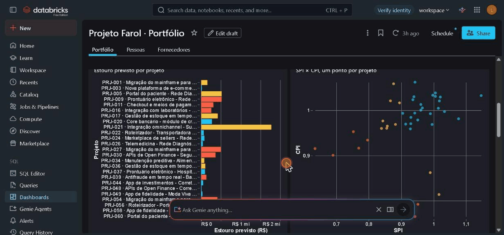
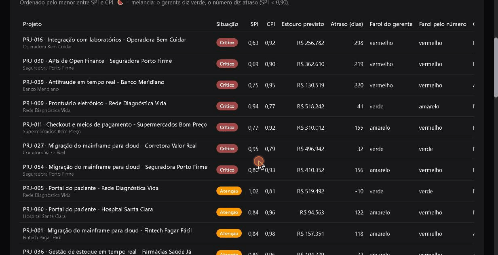
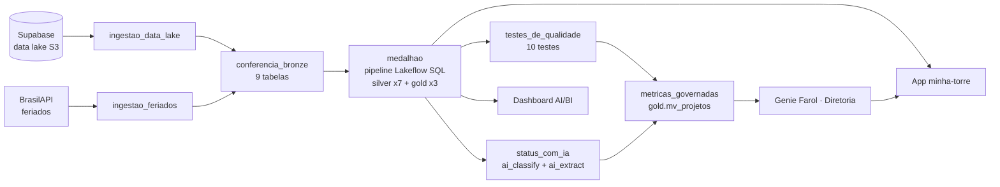
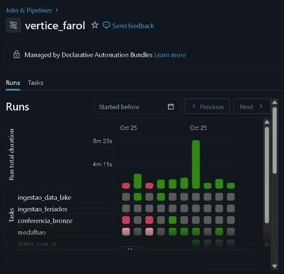
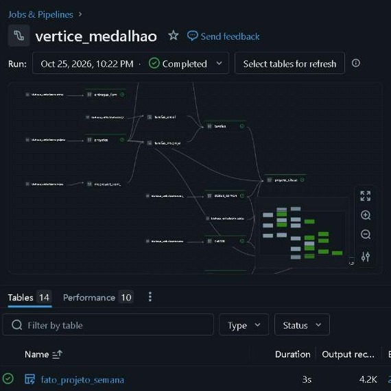
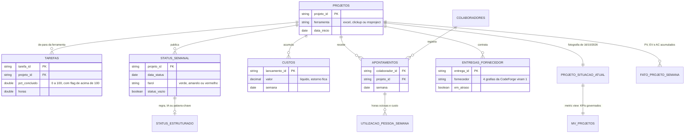
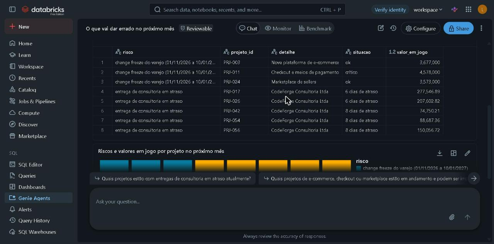
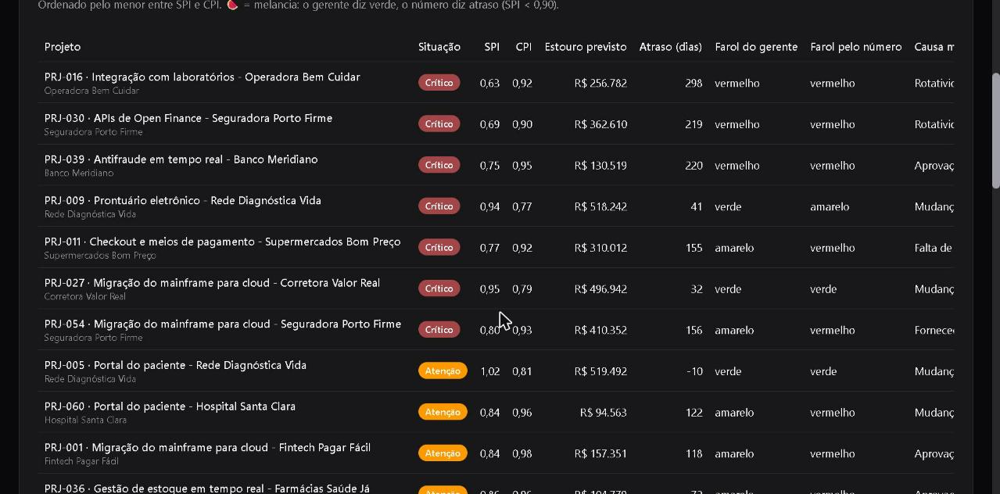
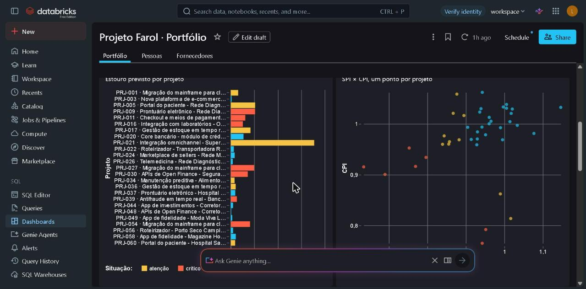

# Projeto Farol · Torre de Controle de Projetos no Databricks

[](https://github.com/lucaspadilha01/Projeto_Databricks_Torre_de_controle/actions/workflows/ci.yml)  

Plataforma de dados ponta a ponta no **Databricks** que responde, em uma tela, as quatro perguntas de um dono de empresa de tecnologia: **quais projetos estão atrasados, quanto esse atraso vai custar, tem gente parada enquanto outro projeto pede gente, e o que vai dar errado no próximo mês.**

Ingestão, limpeza, modelagem, testes, IA, métricas governadas, dashboard, agente em linguagem natural (Genie) e um app web, tudo **como código** em um único bundle (Declarative Automation Bundles), recalculado sozinho toda segunda às 6h.

> Projeto construído durante a **Imersão Jornada de Dados** (outubro/2026), a partir de um caso fictício: a Vértice Tecnologia, com 60 projetos, 520 pessoas e R$ 305 mi de carteira. Todos os dados são sintéticos.

## Resultado de negócio

Uma torre de controle que consolida 60 projetos controlados em **Excel, ClickUp e MS Project** e mostra, toda segunda de manhã:

- **R$ 6,47 mi de estouro de custo previsto** na carteira em andamento (R$ 208,6 mi);
- **17 de 41 projetos em risco**, 7 deles críticos;
- **4 "melancias"**: o gerente publica farol verde, mas o número diz atraso;
- **2 SREs parados** (6% de uso) enquanto um projeto perde 57 dias por falta de SRE: realocar vale ~R$ 22 mil e recupera 19 dias;
- **1 fornecedor** que entrega com 1,41× o prazo prometido e nenhuma entrega no prazo.

| Dashboard AI/BI | App (Databricks Apps) |
|---|---|
|  |  |

## O problema

Cada gerente controla o projeto numa ferramenta diferente: **20 em planilhas Excel, 25 no ClickUp e 15 no MS Project**. Os dados chegam sujos (datas em dois formatos, percentual como `45%` ou `0.45`, vírgula decimal, status escrito de 12 jeitos, cadastro duplicado) e ninguém consegue dizer quais projetos estão atrasados.

## O que foi construído

| Camada | O que faz | Onde |
|---|---|---|
| **Ingestão** | Baixa os arquivos do data lake (Supabase, protocolo S3, `boto3`) e os feriados da BrasilAPI; recria 9 tabelas bronze | `src/ingestao/` |
| **Conferência** | Compara as 9 tabelas da bronze com a contagem esperada e para o job com `raise_error()` se divergir | `src/conferencia/` |
| **Silver** (7 tabelas) | Limpa, tipa e **integra as três ferramentas num modelo só** (`silver.tarefas`); `EXPECT ... FAIL UPDATE` declara o contrato | `src/silver/` |
| **Gold** (4 tabelas) | `fato_projeto_semana` (PV, EV, AC acumulados), `projeto_situacao_atual` (a fotografia de hoje), `utilizacao_pessoa_semana` e `status_estruturado` | `src/gold/`, `src/ia/` |
| **Testes** | 10 testes de qualidade, cada um com `raise_error` | `src/testes/` |
| **IA** | Transforma o texto livre do status semanal em colunas (causa do bloqueio, quem destrava, dias de impacto) com `ai_classify` e `ai_extract` | `src/ia/` |
| **Métricas governadas** | Metric view `gold.mv_projetos`: a fórmula de cada KPI num lugar só | `src/metricas/` |
| **Dashboard** | AI/BI com 3 páginas, gerado por script (dashboard como código) | `scripts/gerar_dashboard.py` |
| **Genie** | Agente "Farol · Diretoria" em português, também gerado por script | `scripts/gerar_genie.py` |
| **App** | Databricks App (AppKit, React): projetos em risco, simulador de realocação e aba Perguntar (Genie) | `minha-torre/` |

## Arquitetura



O job `vertice_farol` tem **7 tarefas**, roda **toda segunda às 6h** (America/Sao_Paulo) e não permite duas execuções ao mesmo tempo (duas execuções apagariam a bronze uma da outra).





### Modelo de dados (silver e gold)



## Decisões de engenharia que valem a leitura

- **Três ferramentas viram uma.** Cada ferramenta tem uma `TEMPORARY VIEW` com as **mesmas colunas**, e um `UNION ALL` forma a `silver.tarefas` (4.917 tarefas: Excel 1.643, ClickUp 2.119, MS Project 1.155). O projeto de cada tarefa vem do cadastro do PMO (o de-para), com fallback pelo `PRJ-xxx` do nome do arquivo.
- **Razão não se soma.** O SPI da carteira é `SUM(ev) / SUM(pv)`, nunca a média dos SPIs dos projetos: um projeto pequeno atrasado não pode pesar igual a um grande. A fórmula mora na metric view e é a mesma no dashboard, no Genie e no app.
- **A limpeza não pode mudar o custo.** O teste 6 compara a soma de `custos` na bronze (com `replace(',', '.')` antes do `CAST`) com a silver: R$ 193,35 mi nos dois. Um `try_cast` teria jogado R$ 5,4 mi fora em silêncio.
- **O "hoje" é uma data fixa** (`DATE'2026-10-16'`), nunca `current_date()`: os números não mudam todo dia e batem com qualquer pessoa que rode o projeto.
- **A IA custa tempo, então roda uma vez só por texto.** `status_estruturado` é `CREATE TABLE IF NOT EXISTS` + `MERGE` com `LEFT ANTI JOIN`: só os status novos passam pela IA (~5 s por texto). Status sem bloqueio resolvem por regra, o histórico antigo por palavra-chave, e só os últimos 90 dias usam `ai_classify` e `ai_extract`.
- **Melancia.** Projeto com farol verde do gerente e SPI abaixo de 0,9. O dashboard e o app mostram o farol do gerente ao lado do farol calculado pelo número, para responder "posso confiar no farol?".
- **Dashboard e Genie como código.** Um script Python gera o JSON de cada um. O JSON fica no Git, com diff e revisão; editar no workspace faz o próximo deploy recusar ("modified remotely").
- **O Genie foi medido.** Benchmark de 20 perguntas com SQL de referência: **20/20**. A primeira rodada deu 12/20 e o erro não era do modelo: era um desenho meu na gold (a coluna `projeto` guardava "código · nome" em vez do código). Corrigi o dado em vez de empilhar instrução.
- **O app não quebra sem o modelo.** O score de estouro (`gold.score_estouro_30d`) é opcional: nenhuma query do app depende dele. Uma rota do servidor lê a tabela e, se ela não existir, responde `{disponivel:false}` e a tela mostra "—".

## Resultados

Todos conferidos contra números de referência (seed 42):

| Métrica | Valor |
|---|---|
| Carteira em andamento | R$ 208,6 mi (41 projetos) |
| SPI · CPI da carteira | 0,92 · 0,96 |
| **Estouro previsto** | **R$ 6,47 mi** |
| Projetos em risco · críticos · melancias | 17 · 7 · 4 |
| Custo real total (bronze = silver) | R$ 193,35 mi |
| SREs ociosos | COL0017 e COL0018, no PRJ-007, com 6% de uso |
| Fornecedor que atrasa | CodeForge: prazo real 1,41× o prometido, 0% no prazo, 5 entregas em atraso |
| Benchmark do Genie | 20/20 |

Simulando a realocação de uma SRE parada para o PRJ-011 (57 dias de impacto por falta de SRE): **151 h no mês, ~R$ 30 mil de ociosidade que deixa de ser paga, 19 dias de cronograma recuperados, R$ 8 mil de onboarding e saldo de ~R$ 22 mil.**

## Telas

| Genie · "O que vai dar errado no próximo mês?" | App · Projetos em risco |
|---|---|
|  |  |

| Dashboard · gráficos |
|---|
|  |

## Stack

Databricks (Free Edition) · Unity Catalog · Lakeflow Spark Declarative Pipelines (SQL) · Databricks Jobs · AI Functions (`ai_classify`, `ai_extract`) · Metric Views · AI/BI Dashboards · Genie · Databricks Apps (AppKit, TypeScript, React, Tailwind) · Declarative Automation Bundles · Python (`boto3`, scripts geradores) · SQL

## Como rodar

Pré-requisitos: um workspace Databricks, a [Databricks CLI](https://docs.databricks.com/dev-tools/cli/install) autenticada (`databricks auth login`), Node 20+ e Python 3.10+.

```bash
cd torre_de_controle

# 1. O catálogo lakehouse_vertice e os schemas bronze, silver e gold precisam existir.
#    As chaves do data lake ficam no secret scope "supabase"
#    (s3_endpoint, s3_region, s3_access_key, s3_secret_key, s3_bucket). Nunca vão para o Git.

# 2. Ajuste o warehouse_id (e o host) em databricks.yml, depois:
databricks bundle validate --profile <perfil>
databricks bundle deploy   --profile <perfil>
databricks bundle run vertice_farol --profile <perfil>

# 3. Dashboard e Genie (geram o JSON que o bundle publica)
python scripts/gerar_dashboard.py
python scripts/gerar_genie.py --profile <perfil>
databricks bundle deploy --profile <perfil>     # o Genie precisa das tabelas: deploy, run, deploy

# 4. App
cd minha-torre
npm install
databricks bundle deploy --profile <perfil>
../scripts/conceder-acesso.sh minha-torre <perfil>   # dá ao app acesso de leitura ao Unity Catalog
databricks apps deploy --profile <perfil>
```

> `scripts/run_sql.py` e `scripts/genie.py` (usados para testar a metric view e rodar o benchmark do Genie) e os arquivos de apoio do curso não estão neste repositório: baixe-os do repositório da imersão, [lvgalvao/ImersaoControlTower](https://github.com/lvgalvao/ImersaoControlTower). No Windows, rode `genie.py` com `python -X utf8`.

## Estrutura

```
.github/workflows/ci.yml          CI: typecheck e lint do app, scripts e varredura de segredos
LICENSE                           MIT
torre_de_controle/
├── databricks.yml                 bundle (variáveis catalog e warehouse_id, targets dev e prod)
├── resources/                     job, pipeline, dashboard e Genie
├── src/
│   ├── ingestao/                  notebooks: data lake (boto3) e feriados (BrasilAPI)
│   ├── conferencia/               confere a bronze
│   ├── silver/  gold/             pipeline declarativo (um arquivo por assunto)
│   ├── ia/                        status_estruturado (ai_classify + ai_extract)
│   ├── testes/                    10 testes de qualidade
│   └── metricas/                  metric view gold.mv_projetos
├── scripts/                       gerar_dashboard.py, gerar_genie.py, conceder-acesso.sh
├── minha-torre/                   Databricks App (AppKit): bundle próprio
└── docs/img/                      capturas de tela
```

## Roadmap

- [ ] **Modelo preditivo de estouro** (`gold.score_estouro_30d`): classificador com corte temporal para evitar vazamento, registrado no Unity Catalog e servido ao app (a aba já está pronta e mostra "—" enquanto a tabela não existe).
- [ ] **Aprovação de realocação**: botão Aprovar/Recusar no simulador gravando a decisão e o e-mail de quem clicou (Lakebase).
- [ ] **Alertas** por e-mail/Slack quando um projeto virar crítico.
- [ ] **CI com deploy** em ambiente de homologação (hoje o CI não usa credenciais do workspace).

## Lições do caminho

- A conferência da bronze **pegou um problema real na fonte**: faltava uma das 20 planilhas do Excel no data lake (85 tarefas a menos). Corrigir na origem, não relaxar o teste.
- O `.gitignore` do repositório tinha a regra `lib/` (de Python), e o deploy do app **não enviou** `client/src/lib/`. O build quebrou com "módulo não encontrado". A pasta virou `helpers/`.
- O warehouse devolve **todo valor como texto**, inclusive booleano: `"false"` é verdadeiro em JavaScript, e o 🍉 apareceu em projetos que não eram melancia. Achei olhando a tela publicada, não nos testes.
- No Windows, o `·` do título do Genie quebrava a busca por nome (codificação do subprocesso).

## Créditos

Caso, dataset sintético e roteiro de prompts da **Imersão Jornada de Dados**, por [Luciano Galvão](https://github.com/lvgalvao). A implementação, as decisões e as correções documentadas acima são deste repositório. Licença [MIT](LICENSE).
